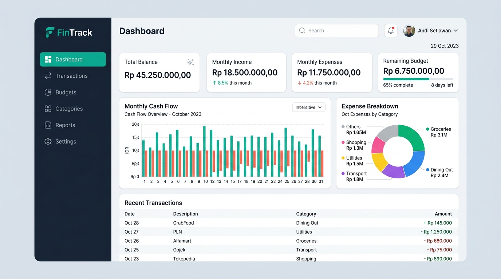
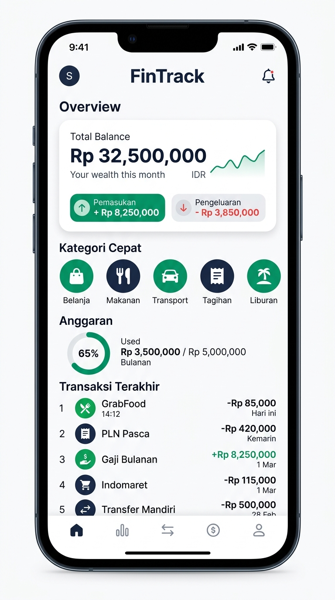

# FinTrack — Personal Finance Tracker

**FinTrack** adalah aplikasi web pengelolaan keuangan pribadi modern, responsif, dan aman yang dibangun menggunakan arsitektur full-stack **Next.js App Router**, **TypeScript**, **Prisma ORM**, dan **Neon PostgreSQL**. Aplikasi ini dirancang sebagai proyek portofolio profesional berstandar industri dengan fokus pada akurasi perhitungan finansial, isolasi data antar-pengguna, visualisasi data interaktif, dan performa tinggi.

---

## 📸 Tampilan Antarmuka (UI/UX Showcase)

### 🖥️ Desktop Dashboard


### 📱 Responsive Mobile View
<p align="center">
  
</p>

---

## 🌟 Fitur Utama

1. **Dashboard Finansial Terpadu**
   - Kartu ringkasan metrik: Total Saldo Bersih akumulasi, Total Pemasukan bulan berjalan, Total Pengeluaran bulan berjalan, dan Sisa Anggaran.
   - Grafik tren arus kas 6 bulan terakhir (Pemasukan vs Pengeluaran) menggunakan **Recharts**.
   - Donut chart komposisi pengeluaran berdasarkan kategori.
   - Daftar 5 transaksi terkini dengan akses cepat penambahan transaksi.
   - Widget pemantauan progres anggaran kategori dengan indikator warna dinamis.

2. **Pengelolaan Transaksi (Full CRUD)**
   - Pencatatan Pemasukan (*Income*) dan Pengeluaran (*Expense*).
   - Pengelompokan berdasarkan kategori dan nominal dalam format Rupiah (**IDR**).
   - Form modal interaktif dengan validasi Zod di sisi klien dan server.
   - Filter lengkap: pencarian teks, jenis transaksi, kategori, dan rentang tanggal.
   - Fitur pengurutan berdasarkan tanggal atau nominal uang.
   - Pagination responsif untuk navigasi data yang banyak.

3. **Alokasi Anggaran Bulanan (Monthly Budgets)**
   - Penetapan batas anggaran per kategori pengeluaran dan periode bulan/tahun.
   - Perhitungan otomatis pengeluaran aktual terhadap anggaran yang dialokasikan.
   - Indikator visual 3 tingkat:
     - **Normal** (< 80%): Hijau (*Emerald*).
     - **Mendekati Batas** (80% - 100%): Kuning/Amber (*Warning*).
     - **Melebihi Batas** (> 100%): Merah (*Over Budget Alert*).
   - Pencegahan anggaran ganda pada kategori dan periode yang sama melalui constraint database.

4. **Kategori Dinamis (Sistem & Pribadi)**
   - Kategori bawaan sistem (*System Categories*) mencakup kebutuhan finansial umum masyarakat Indonesia.
   - Pengguna dapat menambahkan kategori pribadi (*Personal Categories*) dengan palet warna dan ikon kustom.
   - Proteksi integritas data: Kategori yang sedang digunakan oleh transaksi atau anggaran tidak dapat dihapus sembarangan.

5. **Laporan Keuangan & Ekspor CSV Aman**
   - Filter laporan kustom berdasarkan rentang tanggal mulai-selesai, jenis, dan kategori.
   - Perhitungan surplus/defisit bersih (*Net Cash Flow*).
   - Unduh laporan dalam format file **CSV** dengan standar UTF-8 BOM (kompatibel penuh dengan Microsoft Excel).
   - Perlindungan terhadap serangan **CSV Formula Injection** (*OWASP CSV Injection*).

6. **Autentikasi & Keamanan Tingkat Tinggi**
   - Registrasi dan Login mandiri dengan hashing kata sandi aman via **bcryptjs** (salt rounds 12).
   - Manajemen sesi database tersimpan rapi dan dikirim via **HTTP-only, Secure, SameSite Cookies**.
   - Pemeriksaan otorisasi di tingkat Server Actions dan Route Handlers (setiap pengguna hanya dapat membaca, mengedit, atau menghapus data miliknya sendiri).
   - Halaman pengaturan profil (nama lengkap, avatar) dan pergantian kata sandi dengan verifikasi kata sandi lama.

---

## 🛠️ Tumpukan Teknologi (Tech Stack)

| Bagian | Teknologi | Keterangan |
| :--- | :--- | :--- |
| **Framework** | Next.js 16 (App Router) | Full-stack React Server Components & Server Actions |
| **Bahasa** | TypeScript | Mode Strict untuk type safety |
| **Database** | Neon PostgreSQL | Serverless PostgreSQL dengan Connection Pooling |
| **ORM** | Prisma ORM 6.4.0 | Schema modeling, query builder, dan migrations |
| **Styling** | Tailwind CSS v4 | Clean Slate & Emerald modern financial design system |
| **Visualisasi** | Recharts | Grafik batang dan donat interaktif |
| **Validasi** | Zod | Skema validasi formulir dan payload server |
| **Ikon** | Lucide React | Ikon modern dan konsisten |
| **Testing** | Vitest | Pengujian unit logic keuangan dan skema validasi |

---

## 📁 Struktur Direktori Proyek

```text
tracker_finance/
├── prisma/
│   ├── schema.prisma             # Skema model User, Session, Category, Transaction, Budget
│   ├── seed.ts                   # Seeder kategori bawaan sistem (Bahasa Indonesia)
│   └── migrations/               # Riwayat migrasi SQL PostgreSQL
├── src/
│   ├── app/
│   │   ├── (dashboard)/          # Halaman terlindungi (Dashboard, Transaksi, Anggaran, Kategori, Laporan, Pengaturan)
│   │   ├── api/export/csv/       # Route Handler untuk ekspor data CSV aman
│   │   ├── login/                # Halaman login akun
│   │   ├── register/             # Halaman registrasi akun baru
│   │   ├── actions/              # Server Actions (Auth, Transaksi, Anggaran, Kategori)
│   │   ├── layout.tsx            # Root layout Next.js
│   │   └── page.tsx              # Landing page publik FinTrack
│   ├── components/
│   │   ├── auth/                 # Form Login dan Register
│   │   ├── budgets/              # Komponen pengelolaan alokasi anggaran
│   │   ├── categories/           # Komponen pengelolaan kategori sistem & pribadi
│   │   ├── dashboard/            # Kartu metrik, grafik Recharts, transaksi terkini
│   │   ├── layout/               # Sidebar responsif, Header, dan drawer mobile
│   │   ├── reports/              # Filter laporan dan visualisasi analitik
│   │   └── transactions/         # Tabel CRUD transaksi dan modal input
│   └── lib/
│       ├── auth.ts               # Utilitas sesi server, bcrypt hash, cookie handler
│       ├── formatters.ts         # Pemformatan mata uang IDR (Rupiah) & tanggal Indonesia
│       ├── prisma.ts             # Singleton Prisma Client
│       └── validations.ts        # Skema Zod
├── tests/
│   ├── finance.test.ts           # Unit test perhitungan saldo, anggaran, sanitasi CSV
│   └── validations.test.ts       # Unit test validasi input data
├── .env.example                  # Template konfigurasi environment
├── package.json
└── README.md
```

---

## 🚀 Panduan Menjalankan Secara Lokal

### 1. Prasyarat Sistem
- **Node.js**: Versi `>= 20.x`
- **npm**: Versi `>= 10.x`
- Akun gratis di [Neon.tech](https://neon.tech) untuk database PostgreSQL cloud.

### 2. Kloning Repositori & Instal Dependensi
```bash
git clone https://github.com/[username]/fintrack.git
cd fintrack
npm install
```

### 3. Konfigurasi Environment Variables
Salin file `.env.example` menjadi `.env`:
```bash
cp .env.example .env
```
Buka file `.env` dan masukkan connection string database Neon PostgreSQL Anda:
```env
# URL koneksi pooled Neon (untuk aplikasi / query)
DATABASE_URL="postgresql://[user]:[password]@[neon-hostname]-pooler.[region].aws.neon.tech/[dbname]?sslmode=require"

# URL koneksi langsung Neon (untuk migrasi skema)
DIRECT_URL="postgresql://[user]:[password]@[neon-hostname].[region].aws.neon.tech/[dbname]?sslmode=require"

# Secret key untuk otentikasi sesi
AUTH_SECRET="your-super-secret-jwt-key-min-32-chars-long"

# URL lokal aplikasi
NEXT_PUBLIC_APP_URL="http://localhost:3000"
NODE_ENV="development"
```

### 4. Menjalankan Migrasi Database & Seeder
Jalankan migrasi skema Prisma ke Neon PostgreSQL:
```bash
npx prisma migrate deploy
```
*(Atau gunakan `npx prisma db push` jika menggunakan database baru)*.

Jalankan seeder untuk mengisi kategori standar Indonesia (Gaji, Bisnis, Makanan, Transportasi, Tagihan, dll.):
```bash
npx prisma db seed
```

### 5. Menjalankan Server Pengembangan (Dev)
```bash
npm run dev
```
Buka browser di `http://localhost:3000`. Anda dapat mendaftar akun baru dan langsung mulai mencatat transaksi.

---

## 🧪 Menjalankan Pengujian Otomatis

Proyek ini dilengkapi dengan rangkaian pengujian unit menggunakan **Vitest** untuk memverifikasi logika bisnis inti:
```bash
npm run test
```

Skenario uji yang dicakup:
- Validasi registrasi, pencocokan password, dan email.
- Validasi nominal transaksi non-nol dan positif.
- Perhitungan saldo bersih `(Total Pemasukan - Total Pengeluaran)`.
- Ambang batas anggaran (Normal `< 80%`, Peringatan `80-100%`, Melebihi `> 100%`).
- Perlindungan keamanan **CSV Formula Injection**.
- Isolasi kepemilikan data antar-pengguna (`userId boundary`).
- Proteksi pencegahan penghapusan kategori aktif.

---

## 🌐 Panduan Deployment Produksi

Aplikasi ini dapat di-deploy dengan cepat ke **Vercel**:
1. Hubungkan repositori GitHub Anda ke Vercel.
2. Pada tab **Environment Variables** di Vercel Dashboard, tambahkan:
   - `DATABASE_URL` (Pooled connection Neon)
   - `DIRECT_URL` (Direct connection Neon)
   - `AUTH_SECRET` (Random 32-karakter string)
   - `NEXT_PUBLIC_APP_URL` (Domain produksi Anda, contoh: `https://fintrack.vercel.app`)
3. Jalankan build command default (`npm run build`). Vercel akan otomatis mengompilasi rute dan server actions.

---

## 🔒 Kebijakan Keamanan & Privasi

- **Tidak Ada Kredensial Hardcoded**: Seluruh informasi database dan rahasia sesi dikelola secara terisolasi melalui environment variables.
- **Server-Side Authorization**: Setiap aksi penambahan, perubahan, atau penghapusan data selalu memvalidasi identitas sesi pengguna aktif.
- **Data Sanitization**: Mencegah script injection (XSS) dan formula injection pada ekspor CSV.
- **Tipe Data Finansial Presisi**: Nominal moneter disimpan menggunakan PostgreSQL `DECIMAL(14,2)` untuk mencegah kesalahan presisi floating-point aritmatika komputer.
